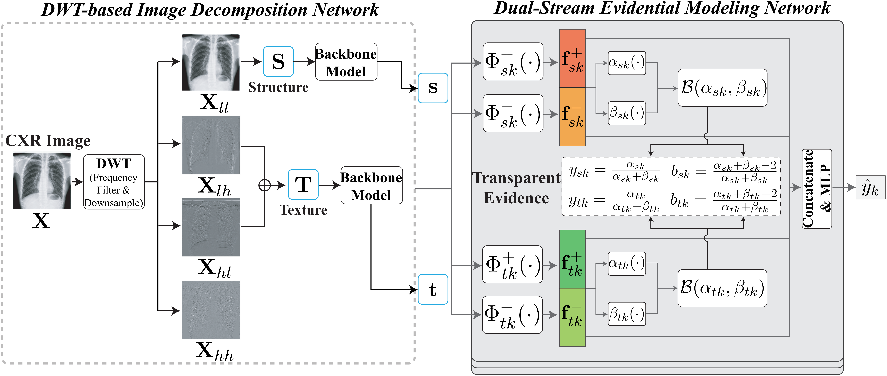

# DuET
Codes for "DuET: A Dual-Stream Evidential Transparency Framework via Wavelet Transform for Interpretable Chest X-ray Classification"

#Introduction
Despite the remarkable success of deep learning in Chest X-ray (CXR) classification, its clinical implementation remains bottlenecked by the black-box nature, susceptibility to shortcut learning, and overconfident predictions lacking uncertainty quantification. These issues fundamentally contradict the principles of evidence-based medicine. Existing interpretability methods often rely on labor-intensive expert priors, limiting their generalizability across diverse clinical tasks. To address this, we propose DuET (Dual-Stream Evidential Transparency Framework), a universal, expert-free framework for interpretable medical image analysis. DuET leverages discrete wavelet transform to decouple CXR images into two complementary components: low-frequency structural information and high-frequency textural information. This design mimics the clinical focus on anatomical morphology and pathological details. Furthermore, DuET integrates evidential deep learning under variational supervision to explicitly output evidence probabilities governed by Beta distributions. This mechanism transforms deterministic predictions into quantifiable evidence distributions, providing a statistically grounded and transparent basis for clinical decisions. Extensive experiments on the public TBX11K and MIMIC-CXR datasets demonstrate that DuET confers interpretability aligned with statistical and medical principles. Significantly, it enhances convergence speed, stability, and diagnostic accuracy, presenting a novel paradigm for building reliable and interpretable medical diagnostic systems.

